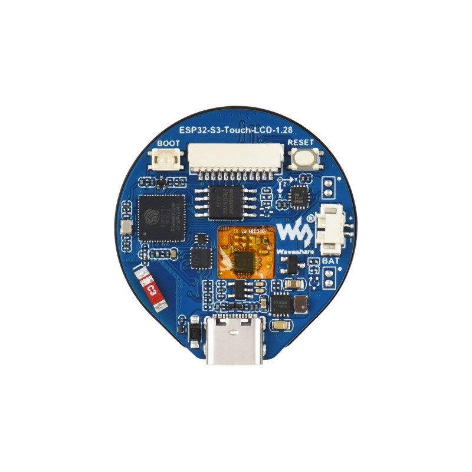

  <h1>ESP32-S3-Touch-LCD-1.28</h1>
  
<strong>ESP32-S3 development board with a 1.28-inch round capacitive touch LCD.</strong>

  
<strong>English</strong> | <a href="README_ZH.md">简体中文</a>

  

    
    
    
  

  

    <a href="https://www.waveshare.com/esp32-s3-touch-lcd-1.28.htm">🛒 Product</a> &middot;
    <a href="firmware/">📦 Firmware</a> &middot;
    <a href="https://docs.espressif.com/projects/esp-idf/en/latest/esp32s3/">🧩 ESP-IDF</a> &middot;
    <a href="examples/arduino/examples/">🔧 Arduino</a> &middot;
    <a href="https://docs.waveshare.com/ESP32-S3-Touch-LCD-1.28">📖 Documentation</a>
  

  

---

## ✨ Overview

ESP32-S3-Touch-LCD-1.28 is a compact ESP32-S3R2 development board with a round 240 × 240 capacitive touch display, motion sensor, USB-C programming interface and battery connector. This repository provides the Arduino sketches, shared libraries and a tested factory image for the board.

| Feature | Device / interface |
| --- | --- |
| MCU | ESP32-S3R2, dual-core Xtensa LX7 up to 240 MHz |
| Memory | 16 MB Flash, 2 MB PSRAM |
| Display | 1.28-inch 240 × 240 round IPS, SPI, GC9A01 |
| Touch | CST816S capacitive touch controller, I2C |
| Motion sensor | QMI8658 6-axis IMU |

## 📦 Quick Start

The Arduino examples use Arduino-ESP32 3.3.11 and the board options recorded in [`.github/product.json`](.github/product.json).

1. Install Arduino IDE and the `esp32` board package.
2. Open an example under [`examples/arduino/examples`](examples/arduino/examples/).
3. Select `ESP32S3 Dev Module` and set the options listed in the example README.
4. Connect the board over USB-C and upload the sketch.

The tested factory image is available in [`firmware`](firmware/). Use it only with the documented flashing procedure for this board.

## 🧪 Examples

### Arduino

| Example | Main feature |
| --- | --- |
| [ESP32-S3-Touch-LCD-1.28-Test](examples/arduino/examples/ESP32-S3-Touch-LCD-1.28-Test/) | LCD, touch, IMU and battery ADC test |
| [LVGL_Arduino](examples/arduino/examples/LVGL_Arduino/) | LVGL user interface on the round display |
| [LVGL_Chinese_Font](examples/arduino/examples/LVGL_Chinese_Font/) | LVGL interface with Chinese font data |
| [LVGL_Chinese_7500_Char](examples/arduino/examples/LVGL_Chinese_7500_Char/) | LVGL interface with a 7,500-character font |

Shared libraries are provided in [`examples/arduino/libraries`](examples/arduino/libraries/).

## 🛠️ Development Environment

| Framework | Version | Examples |
| --- | --- | ---: |
| Arduino-ESP32 | 3.3.11 | 4 |

## 📚 Resources

- [Product page](https://www.waveshare.com/esp32-s3-touch-lcd-1.28.htm)
- [Wiki](https://docs.waveshare.com/ESP32-S3-Touch-LCD-1.28)

## 🤝 Support

- Example or repository problem: [open an issue](https://github.com/waveshareteam/ESP32-S3-Touch-LCD-1.28/issues/new/choose).
- Product usage, hardware or order questions: [Waveshare support](https://service.waveshare.com/).

## 📄 License

Apache License 2.0. See [LICENSE](LICENSE).
