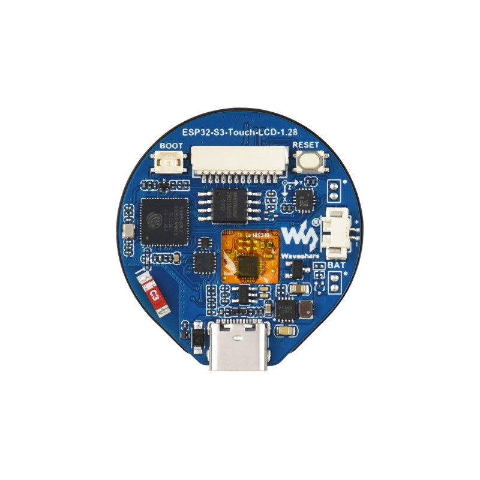

  <h1>ESP32-S3-Touch-LCD-1.28</h1>
  
<strong>搭载 1.28 英寸圆形电容触摸 LCD 的 ESP32-S3 开发板。</strong>

  
<a href="README.md">English</a> | <strong>简体中文</strong>

  

    
    
    
  

  

    <a href="https://www.waveshare.com/esp32-s3-touch-lcd-1.28.htm">🛒 产品</a> &middot;
    <a href="firmware/">📦 固件</a> &middot;
    <a href="https://docs.espressif.com/projects/esp-idf/en/latest/esp32s3/">🧩 ESP-IDF</a> &middot;
    <a href="examples/arduino/examples/">🔧 Arduino</a> &middot;
    <a href="https://docs.waveshare.net/ESP32-S3-Touch-LCD-1.28/">📖 文档</a>
  

  

---

## ✨ 概述

ESP32-S3-Touch-LCD-1.28 是一款紧凑的 ESP32-S3R2 开发板，配有 240 × 240 圆形电容触摸屏、六轴运动传感器、USB-C 编程接口和电池接口。本仓库提供 Arduino 示例、共用库和经过实测的出厂固件。

| 功能 | 器件或接口 |
| --- | --- |
| MCU | ESP32-S3R2，双核 Xtensa LX7，最高 240 MHz |
| 存储器 | 16 MB Flash，2 MB PSRAM |
| 显示 | 1.28 英寸 240 × 240 圆形 IPS，SPI，GC9A01 |
| 触摸 | CST816S 电容触摸控制器，I2C |
| 运动传感器 | QMI8658 六轴 IMU |

## 📦 快速开始

Arduino 示例使用 Arduino-ESP32 3.3.11，开发板选项记录在 [`.github/product.json`](.github/product.json) 中。

1. 安装 Arduino IDE 和 `esp32` 开发板软件包。
2. 打开 [`examples/arduino/examples`](examples/arduino/examples/) 下的示例。
3. 选择 `ESP32S3 Dev Module`，并按示例 README 设置选项。
4. 通过 USB-C 连接开发板并上传程序。

经过实测的出厂镜像位于 [`firmware`](firmware/) 目录，请按照本产品文档中的烧录流程使用。

## 🧪 示例

### Arduino

| 示例 | 主要功能 |
| --- | --- |
| [ESP32-S3-Touch-LCD-1.28-Test](examples/arduino/examples/ESP32-S3-Touch-LCD-1.28-Test/) | LCD、触摸、IMU 和电池 ADC 测试 |
| [LVGL_Arduino](examples/arduino/examples/LVGL_Arduino/) | 在圆形屏幕上运行 LVGL 用户界面 |
| [LVGL_Chinese_Font](examples/arduino/examples/LVGL_Chinese_Font/) | 使用中文字体数据的 LVGL 界面 |
| [LVGL_Chinese_7500_Char](examples/arduino/examples/LVGL_Chinese_7500_Char/) | 使用 7500 字中文字体的 LVGL 界面 |

草图使用的共用库位于 [`examples/arduino/libraries`](examples/arduino/libraries/)。

## 🛠️ 开发环境

| 开发框架 | 版本 | 示例数 |
| --- | --- | ---: |
| Arduino-ESP32 | 3.3.11 | 4 |

## 📚 资料

- [产品页](https://www.waveshare.com/esp32-s3-touch-lcd-1.28.htm)
- [Wiki](https://docs.waveshare.net/ESP32-S3-Touch-LCD-1.28/)

## 🤝 支持

- 产品使用、硬件或订单问题：[微雪技术支持](https://docs.waveshare.net/ESP32-S3-Touch-LCD-1.28/Technical-Support/)。

## 📄 许可证

Apache License 2.0，详见 [LICENSE](LICENSE)。
